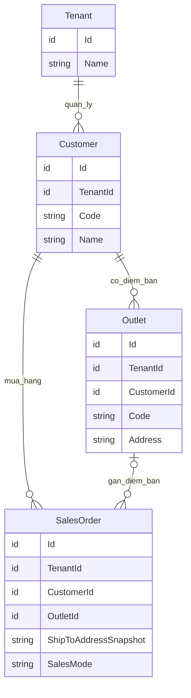
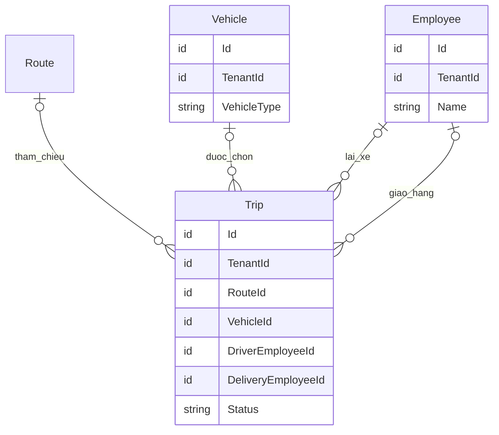
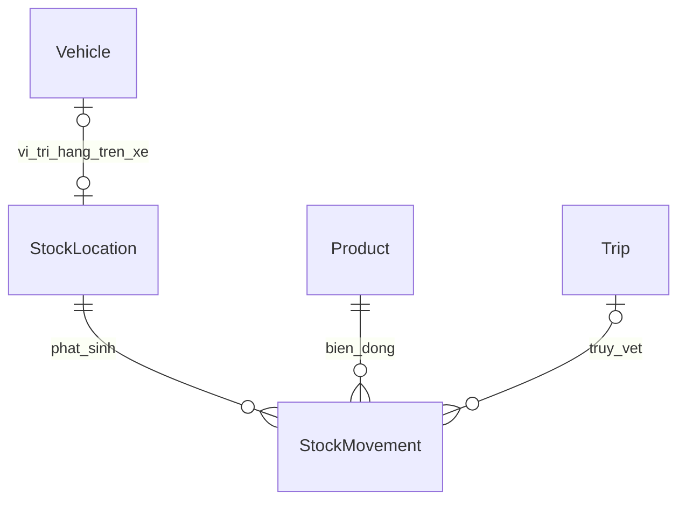

# R002-D01 — Lựa chọn mô hình A/B, nhân sự giao hàng và quy chuẩn thuật ngữ

- Ngày ghi nhận: **11/11/2026**.
- Báo cáo liên quan: [R002 — Nghiệp vụ nhà phân phối FMCG và MVP PWA](report.vi.md).
- Đề bài và phạm vi trước đó: [B002](../../briefs/2026-11-11-02-nghiep-vu-mvp-pwa.md).
- Loại tài liệu: **phụ lục quyết định và đề xuất chuẩn hóa nghiệp vụ/dữ liệu**.
- Trạng thái: **mục 1 ghi các lựa chọn do chủ dự án xác nhận; mục 2–9 là quy chuẩn và mô hình đề xuất để đáp ứng các lựa chọn đó, chưa được ghi là đặc tả đã nghiệm thu**.

Phụ lục này là nơi đọc các lựa chọn mới và cách diễn đạt thống nhất khi sử dụng R002 làm đầu vào cho đặc tả. Báo cáo gốc được giữ nguyên theo [AGENTS.md](../../AGENTS.md) và [hồ sơ xuất xứ R002-S](sources.md). Việc bổ sung phụ lục không xác minh lại toàn bộ nhận định thị trường, pháp lý hay công nghệ trong R002.

## 1. Các lựa chọn đã được chủ dự án xác nhận

| Mã | Nội dung đã xác nhận | Cách hiểu trong tài liệu tiếp theo |
|---|---|---|
| QD-01 | Chọn **Module A và Module B** trong phần các mô hình bán hàng của R002. | A = đặt trước rồi giao; B = mang hàng theo xe để bán tại điểm. R002 gọi là **Model A/Model B**; “Module” trong lựa chọn này chỉ phạm vi nghiệp vụ, chưa quy định cách chia ứng dụng hoặc dịch vụ. |
| QD-02 | Giao hàng bằng **xe máy**: nhân viên giao hàng đồng thời là nhân viên lái xe. | Một người đảm nhiệm hai vai trò trên cùng chuyến. |
| QD-03 | Giao hàng bằng **xe tải**: có thể có đồng thời một nhân viên giao hàng và một nhân viên lái xe. | Phải biểu diễn được hai người khác nhau. Từ “có thể” không đặt ra yêu cầu mọi chuyến xe tải phải có hai người. |
| QD-04 | Cần định nghĩa rõ khách hàng, customer, điểm bán, đại lý, NPP, doanh nghiệp và tenant. | Chuẩn hóa nghĩa trong tài liệu, giao diện và mô hình dữ liệu; không dùng các từ này thay thế lẫn nhau. |

Lựa chọn **PWA cho nhân viên thị trường** và phạm vi MVP về đơn hàng, kho, hóa đơn điện tử, thu tiền/công nợ, báo cáo đã được ghi trước đó tại B002 và README; vẫn là đầu vào của phụ lục này.

**Phạm vi chưa được mở rộng bởi lựa chọn này:** Model C như một phân hệ telesales/CRM riêng và Model D như cổng để khách hàng tự đặt chưa được chọn trong lượt này. Nhận đơn điện thoại/Zalo bằng thao tác nhập của nhân viên vẫn thuộc A như mô tả R002. Việc nhập một đơn có nguồn Zalo không tự tạo yêu cầu tích hợp Zalo OA/API.

## 2. Hai mô hình bán hàng và tác động nghiệp vụ

### 2.1. Tách mô hình bán hàng, nguồn đơn và loại xe

| Chiều phân loại | Tên khái niệm đề xuất | Ví dụ | Ý nghĩa |
|---|---|---|---|
| Mô hình bán hàng | `SalesMode` | `PreOrder`, `VanSales` | Hàng được giao theo đơn đã có, hay được mang đi để bán tại điểm. |
| Nguồn tiếp nhận đơn | `OrderSource` | `FieldVisit`, `Phone`, `ZaloManual` | Nhân viên nhận yêu cầu bằng cách nào. Các giá trị là ví dụ đặt tên. |
| Loại phương tiện | `VehicleType` | `Motorbike`, `Truck` | Phương tiện và quy tắc phân công nhân sự. |

Xe tải giao các đơn đặt trước thuộc A. Xe máy mang hàng đi chào bán tại điểm có thể thuộc B. Trong tài liệu này, **VanSales/bán theo xe** diễn tả cách bán, không bắt buộc phương tiện là ô tô van.

### 2.2. Module A — Đặt trước rồi giao

Luồng đề xuất để đặc tả tiếp:

1. Nhân viên nhận đơn, xác định **khách hàng mua hàng** và **điểm bán/địa chỉ giao thực tế**, ghi sản phẩm, số lượng, giá và nguồn đơn. Bản ghi ngoại tuyến cần thể hiện đang chờ đồng bộ/kiểm tra.
2. Người có quyền duyệt kiểm tra đơn theo chính sách về giá, hạn mức công nợ và khả năng đáp ứng hàng. Cách duyệt thủ công/tự động là chính sách cần đặc tả riêng.
3. Kho chuẩn bị hàng cho đơn; người điều phối tạo chuyến, chọn phương tiện và phân công người giao hàng, người lái xe. Ghi nhận bàn giao hàng cho chuyến.
4. Người giao hàng ghi kết quả nhận hàng, giao thiếu, từ chối nhận hoặc hàng mang về. Thu tiền nếu được phân quyền; có thể giao hàng và ghi công nợ theo chính sách của khách hàng.
5. Kết thúc chuyến, đối soát chứng từ giao nhận, hàng mang về và tiền đã thu/bàn giao. Trạng thái giao hàng, thanh toán và hóa đơn được theo dõi riêng.

Hàng trên xe trong A chủ yếu phục vụ các đơn đã được phân giao. Cần theo dõi hàng đang giao và trách nhiệm bàn giao; không mặc nhiên coi phần hàng đó là tồn tự do để tạo các giao dịch B.

Sổ kho cần ghi nhất quán nơi xuất, nơi đang giữ hàng và nơi hoàn tất giao. Xác nhận giao không được trừ kho nguồn lần thứ hai nếu việc xuất khỏi kho nguồn đã được ghi lúc bàn giao hàng cho chuyến.

### 2.3. Module B — Bán theo xe

Luồng đề xuất để đặc tả tiếp:

1. Lập chuyến, nhận hàng từ kho và ghi lượng hàng bàn giao lên xe. **Chuyển hàng lên xe chưa phải bán hàng và chưa tự tạo doanh thu/công nợ khách hàng.**
2. Tại từng điểm bán, người bán xác định khách hàng, lập giao dịch bán và giao hàng từ số hàng trên xe; ghi tiền thu hoặc công nợ theo chính sách.
3. Theo dõi các biến động hàng trên xe: nhận bổ sung, xuất bán, hàng tặng, hàng khách trả, trả về kho và điều chỉnh có lý do/phê duyệt phù hợp.
4. Kết chuyến, kiểm đếm thực tế và đối soát lượng hàng, các giao dịch bán, tiền đã thu và tiền bàn giao. Chênh lệch được ghi thành ngoại lệ cần xử lý.

Vì B đã được chọn, **tồn hàng trên xe và đối soát cuối chuyến là nội dung phải có trong đặc tả của B**. Chi tiết lô/hạn dùng, giá vốn và cơ chế kiểm soát nhiều thiết bị vẫn cần quyết định riêng.

Đẳng thức kiểm soát số lượng, sau khi quy về cùng đơn vị tính:

`Tồn cuối sổ = Tồn đầu + Tổng nhận cấp cho chuyến + Khách trả về xe - Xuất bán - Xuất tặng - Trả về kho ± Điều chỉnh được duyệt`

`Tồn đầu` là số dư hàng trên xe khi mở chuyến, trước các lần nhận được cộng trong công thức. `Tổng nhận cấp cho chuyến` gồm cấp ban đầu và các lần cấp bổ sung; mỗi lần nhận chỉ được tính một lần.

Hàng đã nhận trả nhưng chưa được phép bán lại cần có trạng thái tồn phù hợp; không tự cộng vào lượng khả dụng. Tiền khách đã đưa, tiền nhân viên đang giữ và tiền đã bàn giao cho doanh nghiệp là các mốc riêng. Ghi nhận thu tiền tại điểm rồi ghi bàn giao tiền không được tạo hai lần thanh toán cho cùng khoản thu.

## 3. Quy chuẩn thuật ngữ đề xuất

Các định nghĩa dưới đây là **quy ước thiết kế cho dự án**, không phải kết luận rằng mọi doanh nghiệp phân phối Việt Nam đều sử dụng thuật ngữ giống nhau.

### 3.1. Bảng thuật ngữ cốt lõi

| Thuật ngữ tiếng Việt | Tên tiếng Anh/code đề xuất | Định nghĩa dùng trong dự án | Phân biệt cần giữ |
|---|---|---|---|
| **Khách hàng mua hàng**; trong màn hình nghiệp vụ được rút gọn thành **Khách hàng** | `Customer` | Hồ sơ quan hệ mua hàng của bên mua với đơn vị bán trong phạm vi một tenant; là đối tượng đứng trên giao dịch mua và theo dõi công nợ theo chính sách đã thỏa thuận. Bên mua có thể là tổ chức, hộ kinh doanh hoặc cá nhân. | Đây là **ai mua/ai chịu công nợ**. Một hồ sơ không tự tương đương một địa điểm, một người liên hệ hoặc một người dùng phần mềm. |
| **customer** | `Customer` trong miền bán hàng | Là cách gọi tiếng Anh của “khách hàng mua hàng” ở hàng trên; không tạo thêm một loại thực thể khác chỉ vì khác ngôn ngữ. | Khi nói về người mua dịch vụ SaaS, phải viết rõ `SaaS subscriber` hoặc “đơn vị thuê dịch vụ SaaS”. |
| **Điểm bán** | `Outlet` | Một cơ sở kinh doanh cụ thể của khách hàng được quản lý để viếng thăm, bán hàng và/hoặc giao hàng; có mã, tên điểm, địa chỉ, vị trí và người liên hệ riêng. | Đây là **điểm hoạt động ở đâu**. Một khách hàng có thể có nhiều điểm bán; địa chỉ xuất hóa đơn có thể khác địa chỉ điểm bán. |
| **Địa điểm giao hàng** | `ShipToLocation` | Nơi nhận thực tế của một lần giao; có thể là điểm bán, kho nhận của khách hoặc địa điểm khác. Chứng từ giữ địa chỉ giao bằng bản chụp dữ liệu tại thời điểm phát sinh. | Không đồng nhất nơi giao, địa chỉ xuất hóa đơn và bên chịu công nợ. Tên khái niệm này chưa bắt buộc tạo thêm bảng địa điểm trong MVP. |
| **Đại lý** | `Dealer` | Vai trò/nhóm thương mại của một đối tác trong quan hệ phân phối, thường được dùng để phân loại một khách hàng mua để bán lại. | Không tạo bảng đại lý đồng nghĩa với `Customer`; không đồng nhất đại lý với một điểm bán. Nhãn này không tự xác nhận bản chất hợp đồng hay quyền đại diện. |
| **Nhà phân phối (NPP)** | `Distributor` | Vai trò của một đơn vị thực hiện phân phối hàng hóa trong chuỗi cung ứng. Phải chỉ rõ NPP đang vận hành hệ thống, NPP cấp dưới mua hàng, hay NPP cung cấp hàng. | NPP vận hành hệ thống có hồ sơ doanh nghiệp; NPP mua hàng có thể là `Customer`; NPP cung cấp hàng có thể là `Supplier`. Vai trò NPP không tự tạo tenant. |
| **Doanh nghiệp** | `Business` | Chủ thể kinh doanh ngoài đời thực. Trong sản phẩm cần nói rõ **doanh nghiệp vận hành** hay **doanh nghiệp đối tác**; hồ sơ gồm tên, thông tin đăng ký/thuế nếu áp dụng và các thông tin giao dịch. | Đây là chủ thể kinh doanh, không phải ranh giới cách ly dữ liệu. Từ này không dùng để tự suy mọi bên mua đều có cùng loại hình pháp lý. Nếu phục vụ cả hộ kinh doanh, dùng nhãn bao quát “Đơn vị kinh doanh”. |
| **Tenant** | `Tenant` | Không gian vận hành trên SaaS có phạm vi dữ liệu, cấu hình và quyền truy cập riêng. Đây là ranh giới logic để cách ly và quản lý việc sử dụng hệ thống. | Không phải khách mua hàng, điểm bán, kho, nhân viên, hay một database theo định nghĩa bắt buộc. Ánh xạ tenant với doanh nghiệp là quyết định sản phẩm/kiến trúc riêng. |
| **Đơn vị thuê dịch vụ SaaS** | `SaaSSubscriber` | Bên có quan hệ thuê/đăng ký dịch vụ với nhà cung cấp phần mềm. Nếu triển khai billing, cần phân biệt chủ thể thuê và tài khoản thanh toán dịch vụ. | Không dùng `CustomerId` của bán hàng để định danh bên thuê SaaS. Không mặc định một bên thuê chỉ có đúng một tenant. |

**Quy tắc đặt tên:** giữ `Customer` để thống nhất với R002, nhưng khóa nghĩa theo bảng trên. Nếu về sau cần tên `CustomerAccount` để nhấn mạnh tài khoản thương mại/công nợ, đó là phương án đổi tên khái niệm này hoặc tách mô hình có chủ đích; không tạo song song hai bảng đồng nghĩa `Customer` và `CustomerAccount`.

`Business`, `Distributor` và `Dealer` ở bảng là tên khái niệm. Bảng thuật ngữ không bắt buộc tạo một bảng SQL cho từng từ. Chưa có cơ sở để đồng thời dựng `Business`, `Company`, `Organization`, `Distributor` thành bốn danh mục trùng chủ thể.

### 3.2. Nghĩa phải ổn định theo ngữ cảnh

| Khi nói về… | Cách viết rõ nghĩa |
|---|---|
| Đơn hàng và công nợ của NPP | “Khách hàng mua hàng”, `CustomerId`. |
| Lịch sales đi thăm, vị trí GPS, nơi thực hiện giao nhận | “Điểm bán”, `OutletId`; địa chỉ giao cụ thể ghi trên chứng từ. |
| Doanh nghiệp đang bán hàng bằng phần mềm | “Doanh nghiệp vận hành” hoặc “NPP vận hành”. |
| Đối tác phân phối mua hàng của doanh nghiệp vận hành | “Khách hàng loại NPP/đại lý”, không gọi chung là tenant. |
| Giá gói phần mềm, hợp đồng SaaS, MRR | “Đơn vị thuê dịch vụ SaaS” hoặc “tài khoản thanh toán dịch vụ”, tùy đối tượng đo. |
| Quyền truy cập và cách ly dữ liệu | “Tenant/không gian vận hành”, `TenantId`. |

Một cửa hàng có thể vừa là tên thường gọi của khách hàng vừa là tên của điểm bán. Giao diện vẫn nên biểu diễn hai khái niệm riêng, kể cả khi có thao tác tạo nhanh “khách hàng kèm điểm bán đầu tiên”. Nhân viên chọn điểm bán có thể được gợi ý khách hàng tương ứng; hệ thống vẫn lưu rõ hai định danh khi giao dịch gắn với điểm đó.

Một địa chỉ giao nhận thuần túy không tự trở thành điểm bán. Địa chỉ tạm, kho nhận hàng của khách hoặc địa chỉ xuất hóa đơn cần được biểu diễn bằng thông tin địa chỉ/địa điểm đúng mục đích; không tạo điểm bán giả chỉ để thỏa mãn một trường bắt buộc.

### 3.3. Ví dụ xuyên suốt

Ví dụ giả định, dùng để giải thích mô hình:

| Đối tượng | Cách biểu diễn |
|---|---|
| Công ty Phân phối An Phát dùng phần mềm để vận hành | An Phát là `Business`, có vai trò `Distributor`; trong ví dụ dùng tenant `T-AP`. Đây là ví dụ triển khai, không phải quy tắc mọi doanh nghiệp chỉ có một tenant. |
| Công ty bán lẻ Minh Lan mua hàng, đứng chung công nợ cho ba cửa hàng | Một `Customer` là Minh Lan trong `T-AP`. |
| Ba cửa hàng Minh Lan tại ba địa chỉ | Ba `Outlet`, cùng liên hệ với Customer Minh Lan. |
| Đơn hàng giao cho cửa hàng số 2 | `CustomerId = MinhLan`, `OutletId = MinhLan02`; lưu địa chỉ giao và thông tin bên mua theo thời điểm chứng từ. |
| Minh Lan được phân loại là đại lý | Đây là phân loại quan hệ thương mại của Customer Minh Lan; không phải một hồ sơ đại lý trùng lặp. |
| NPP Bình Minh mua hàng từ An Phát | Bình Minh là một `Customer` có vai trò/phân loại NPP trong `T-AP`. |
| Bình Minh cũng thuê phần mềm để vận hành riêng | Có thể có tenant `T-BM` theo hợp đồng/cấu hình riêng; hồ sơ mua hàng tại `T-AP` không tự mở quyền đọc dữ liệu của `T-BM`. |

Nếu ba cửa hàng Minh Lan thực tế mua và chịu công nợ độc lập, cần xác định lại bên mua/tài khoản công nợ; không gom chỉ vì cùng tên thương hiệu. Ngược lại, không tạo ba Customer chỉ vì có ba địa chỉ khi cùng một bên chịu công nợ.

## 4. Vai trò nhân sự và phân công theo chuyến

### 4.1. Một người, nhiều vai trò

| Khái niệm | Tên đề xuất | Trách nhiệm được biểu diễn |
|---|---|---|
| Nhân viên | `Employee` | Con người được doanh nghiệp phân công công việc. |
| Tài khoản người dùng | `UserAccount` | Danh tính đăng nhập và thực hiện thao tác hệ thống; có thể liên kết hồ sơ nhân viên. |
| Nhân viên bán hàng | `Salesperson` | Giới thiệu, nhận đơn, lập giao dịch bán; thu tiền khi được cấp quyền. |
| Nhân viên giao hàng | `DeliveryPerson` | Bàn giao hàng tại điểm, ghi kết quả giao nhận; thu tiền khi được cấp quyền. |
| Nhân viên lái xe | `Driver` | Điều khiển phương tiện trong chuyến được phân công. |
| Tuyến kế hoạch | `Route` | Danh sách/lịch dự kiến các điểm cần phục vụ; có thể được sử dụng nhiều lần. |
| Chuyến thực tế | `Trip` | Một lần thực hiện có thời gian, xe, nhân sự, các điểm dừng và kết quả. Có thể tham chiếu tuyến, hoặc lập chuyến ngoài tuyến. |

Không tạo hai hồ sơ nhân viên cho cùng một người chỉ để thể hiện “lái xe” và “giao hàng”. Không lấy `UserAccount` thay cho `Employee`: người lái xe có thể có hồ sơ nhân viên mà chưa cần tài khoản thao tác PWA. Với người có tài khoản, quan hệ với nhân viên và quyền trong tenant cần được xác định rõ.

### 4.2. Phân công tối thiểu đề xuất

Mỗi chuyến có `VehicleId`, `DriverEmployeeId`, `DeliveryEmployeeId`. Đây là các tham chiếu đến phương tiện và hồ sơ nhân viên trong cùng tenant. Có thể dùng bảng phân công theo vai trò ở thiết kế vật lý; yêu cầu ngữ nghĩa vẫn giống nhau.

| Phương tiện | `DriverEmployeeId` | `DeliveryEmployeeId` | Ràng buộc khi chuyến bắt đầu |
|---|---|---|---|
| Xe máy | NV01 | NV01 | Cùng một nhân viên theo QD-02. |
| Xe tải, một người kiêm nhiệm | NV02 | NV02 | Biểu diễn được việc kiêm nhiệm; lựa chọn của Owner không bắt buộc tách người. |
| Xe tải, hai người | NV02 | NV03 | Biểu diễn đúng hai người khác nhau theo QD-03. |

Chuyến đang lập có thể chưa đủ phân công; đề xuất chỉ cho bắt đầu chuyến giao hàng khi đã xác định xe và hai vai trò bắt buộc. Nếu dùng bảng phân công, cùng `EmployeeId` được phép mang hai vai trò trên một chuyến; không đặt ràng buộc ngăn kiêm nhiệm.

Người bán trên giao dịch (`SalesEmployeeId`) là thông tin riêng. Người bán có thể trùng người giao hoặc lái xe khi được phân công, nhưng câu “tài xế-sales” trong R002 không trở thành quy tắc ép ba vai trò luôn là một người. Nếu B có người bán đi cùng xe, ghi nhận thêm phân công `Salesperson`; số người bán và số thiết bị thao tác là phần cần đặc tả tiếp.

**Phân công và quyền thao tác là hai lớp khác nhau.** Vai trò lái xe không tự cấp quyền xác nhận giao hàng, sửa giá, thu tiền hay đối soát. Người giao được phân công cũng chỉ thực hiện các thao tác được cấp quyền. Chứng từ cần phân biệt người được giao việc, người thực hiện thực tế và tài khoản ghi nhận.

Khi đổi xe hoặc đổi người giữa chuyến, lưu lịch sử bàn giao và thời điểm hiệu lực. Chứng từ đã phát sinh giữ thông tin thực tế của thời điểm đó; không lấy phân công mới để ghi đè trách nhiệm cũ.

## 5. ERD khái niệm đề xuất

Các sơ đồ chỉ thể hiện các quan hệ cần làm rõ trong yêu cầu này; không phải toàn bộ schema SQL hay thiết kế sẵn để migration. Kiểu `id` là ký hiệu định danh, chưa chọn UUID/số nguyên. Quan hệ ở sơ đồ đều xét trong phạm vi tenant phù hợp.

### 5.1. Khách hàng, điểm bán và đơn hàng

Quy tắc đọc và triển khai:

1. Một Customer thuộc một tenant và có thể có **0..n Outlet**. Cho phép hồ sơ khách hàng chưa nhập điểm bán; mỗi Outlet trong mô hình MVP có đúng một Customer chịu trách nhiệm quan hệ mua hàng tại một thời điểm.
2. Một SalesOrder luôn có **một Customer**. `OutletId` có thể trống khi giao dịch không gắn với điểm bán cụ thể; nếu giao dịch gắn với một điểm bán thì phải lưu điểm đó, kể cả khi địa chỉ nhận hàng khác địa chỉ điểm bán. Ví dụ, đơn của MinhLan02 giao về kho trung tâm vẫn giữ `OutletId = MinhLan02`, còn địa chỉ kho được lưu ở thông tin giao hàng. Trước bước giao hàng phải xác định được địa chỉ giao thực tế và người nhận phù hợp.
3. Nếu có `OutletId`, điểm bán phải thuộc Customer đã chọn và cùng tenant tại thời điểm lập giao dịch. API kiểm tra liên kết này; không chỉ tin lựa chọn từ giao diện.
4. Lưu thông tin bên mua và địa chỉ giao theo thời điểm chứng từ. Đổi tên/địa chỉ trong danh mục không tự thay nội dung chứng từ lịch sử.
5. Khi điểm bán đổi chủ, giữ giao dịch/công nợ cũ với Customer cũ. Phương án MVP đề xuất là kết thúc hiệu lực hồ sơ Outlet cũ, tạo hồ sơ kế nhiệm cho Customer mới và lưu liên kết truy vết. Nếu muốn giữ nguyên một OutletId theo địa điểm vật lý, cần quan hệ Customer–Outlet có thời gian hiệu lực; không cập nhật chủ mới rồi diễn giải lại lịch sử theo quan hệ hiện tại.
6. Thông tin tín dụng và khoản phải thu đặt ở Customer theo bên chịu nghĩa vụ thanh toán; báo cáo có thể phân tích thêm theo Outlet. Hạn mức riêng từng Outlet, người trả thay hay tài khoản công nợ theo chi nhánh là chính sách bổ sung, chưa mặc định bật.

`Business` và `SaaSSubscriber` chưa được nối với `Tenant` bằng một cardinality cố định: yêu cầu hiện tại chưa quyết định mô hình một/nhiều doanh nghiệp trong tenant hoặc một/nhiều tenant cho một bên thuê dịch vụ. Định nghĩa tenant cũng chưa chọn database dùng chung hay database riêng. Tài liệu Microsoft phân biệt tenant logic với deployment và nêu trường hợp một khách thuê có nhiều tenant; đây là căn cứ để giữ các khái niệm riêng [S3].

### 5.2. Tuyến, chuyến, phương tiện và nhân viên

Các quan hệ phương tiện/nhân viên cho phép trống ở bản nháp. Khi bắt đầu chuyến, ràng buộc ở mục 4.2 áp dụng; hai quan hệ đến Employee có thể trỏ cùng một bản ghi. Nếu thay phương tiện/người trong hành trình, thiết kế chi tiết phải lưu được các lần phân công, không chỉ giữ ba cột “hiện tại”.

Một chuyến phục vụ nhiều điểm dừng; mỗi điểm dừng có thể giao nhiều đơn. Đơn có thể giao từng phần qua nhiều lần giao. Vì vậy không gắn cứng một `TripId` vào SalesOrder rồi coi đó là toàn bộ lịch sử giao hàng. Cần thực thể giao nhận và dòng giao nhận liên kết về đơn/dòng đơn.

### 5.3. Tồn hàng thuộc doanh nghiệp vận hành

`StockLocation` là nơi doanh nghiệp quản lý hàng: kho hoặc vị trí hàng trên xe. Mỗi vị trí có loại rõ ràng; vị trí loại xe gắn với xe, vị trí kho không cần xe. Sơ đồ MVP không bắt buộc một vị trí tồn độc lập cho mọi ngăn trên xe.

`StockMovement` ghi biến động có chứng từ, thời điểm, sản phẩm, lượng/quy đổi và nguồn truy vết. Một lần chuyển hàng có các bút toán liên quan ở nơi xuất và nơi nhận; ghi nhận phải giữ được tính nhất quán của cả lần chuyển. Lô/hạn dùng và trạng thái hàng được bổ sung khi phạm vi đã chốt.

**Outlet của khách hàng không tự là kho của NPP.** Dữ liệu kiểm đếm hàng tại điểm bán do sales ghi nhận, nếu cần, là quan sát tồn tại điểm (`OutletStockObservation`); chỉ hàng thuộc phạm vi doanh nghiệp thực sự quản lý mới đi vào sổ tồn của doanh nghiệp. Ký gửi cần quy trình và quyền sở hữu hàng riêng.

## 6. Ràng buộc chung cho dữ liệu và chứng từ

| Mã | Quy chuẩn đề xuất | Lý do |
|---|---|---|
| DL-01 | Mọi bản ghi nghiệp vụ có phạm vi tenant rõ ràng; Customer, Outlet, Employee, Vehicle, Trip và các chứng từ liên kết phải cùng phạm vi được phép. | Giữ cách ly dữ liệu; không dùng một CustomerId hợp lệ ở tenant khác. |
| DL-02 | Tên và địa chỉ không thay thế định danh. Mã khách hàng/điểm bán được xác định duy nhất trong tenant theo quy tắc mã của sản phẩm. | Hai tenant có thể cùng dùng mã KH001 mà không phải cùng một hồ sơ. |
| DL-03 | Tách `UserAccount`, tư cách truy cập tenant và `Employee`. Nếu một người có quyền nhiều tenant, quyền ở từng tenant được kiểm tra riêng. | Đăng nhập được không đồng nghĩa có quyền trên mọi dữ liệu hay chuyến. |
| DL-04 | Danh mục phân loại `Dealer`/`Distributor` mô tả quan hệ thương mại; thay phân loại không tự thay TenantId, bên chịu công nợ hoặc quyền đăng nhập. | Tránh biến một nhãn kinh doanh thành quyền truy cập. |
| DL-05 | SalesOrder, giao nhận, chuyển/xuất kho, hóa đơn và thu tiền là các khái niệm/chứng từ riêng. | Đơn đã duyệt chưa có nghĩa giao đủ, xuất hóa đơn xong hoặc đã thu hết tiền. |
| DL-06 | Bàn giao tiền thu là sự di chuyển tiền đang giữ, liên kết khoản thu gốc; không ghi thêm lần giảm nợ cho khách. | Tránh ghi nhận thanh toán hai lần. |
| DL-07 | Chứng từ, tiền thu, biến động kho và xác nhận giao hàng có định danh thao tác ổn định khi đồng bộ lại; máy chủ phát hiện gửi lặp và kiểm tra quyền/phạm vi. | Cùng một thao tác gửi lại không tạo thêm đơn, phiếu thu hay xuất kho. |
| DL-08 | PWA phân vùng dữ liệu cục bộ theo tenant/tài khoản và giữ tenant gốc của bản ghi chờ đồng bộ; kiểm tra lại quyền khi đồng bộ. | Đổi tenant/đăng nhập không làm dữ liệu cũ bị gửi vào hoặc hiển thị trong phạm vi mới. |

Với database dùng chung, có thể thực hiện ràng buộc tham chiếu bằng khóa gồm `TenantId` và định danh bản ghi, kết hợp kiểm tra truy cập. Với database riêng, vẫn cần xác định đúng tenant khi định tuyến, lưu tệp, cache và đồng bộ. Đây là nguyên tắc dữ liệu đề xuất; lựa chọn cách lưu vật lý chưa được chốt.

Phụ lục không đặt quy tắc phát hành hóa đơn tự động ngay sau duyệt đơn, không đồng nhất đơn trả hàng với chứng từ điều chỉnh hóa đơn, và không chuyển các nhận định pháp lý trong R002 thành acceptance criteria mới. Các mốc tài chính/pháp lý phải được đặc tả và kiểm chứng trong công việc tương ứng.

Với thao tác đồng bộ, cùng định danh và cùng nội dung phải trả lại kết quả đã xử lý; cùng định danh nhưng khác nội dung phải báo xung đột. Đề xuất chưa đóng đối soát chính thức chuyến B khi còn giao dịch ngoại tuyến chưa được tiếp nhận hoặc chênh lệch chưa được xử lý. Nếu đổi ID tạm sang ID máy chủ, vẫn phải giữ ánh xạ và định danh chống lặp ổn định.

## 7. Ánh xạ cách gọi trong R002 sang tài liệu mới

| Cách gọi/mô tả trong báo cáo gốc | Cách dùng khi viết đặc tả tiếp theo |
|---|---|
| “Model A”, “Model B” | Mô hình A/Module A và mô hình B/Module B theo QD-01. |
| “Tài xế-sales” | Nhân viên bán hàng, người giao hàng và người lái xe được phân công; chỉ kiêm nhiệm khi cùng một người thực hiện. |
| “Khách hàng (đại lý/NPP, địa chỉ, hạn mức tín dụng)” | Customer giữ bên mua/công nợ; Dealer/Distributor là vai trò/phân loại; Outlet/địa chỉ giữ nơi hoạt động/giao nhận. |
| “User (nhân viên)” | Employee và UserAccount có liên hệ nhưng là hai khái niệm riêng. |
| “Inventory … cửa hàng”, “Product x Location” | Phân biệt tồn hàng doanh nghiệp tại StockLocation với quan sát tồn tại Outlet của khách hàng. |
| “Tách DB cho mỗi khách hàng khác nhau (multi-tenant)” | Viết “lựa chọn cách lưu và cách ly dữ liệu theo tenant”; không dùng Customer bán hàng làm đơn vị tách database. |
| “2–3 khách hàng đại lý nhỏ” trong kế hoạch pilot | Cần chỉ rõ đơn vị thuê/vận hành pilot và những Customer/Outlet tham gia trong tenant của đơn vị đó; giữ số lượng trong R002 là đề xuất lịch sử chưa chốt đối tượng. |
| “Khách hàng trả phí” khi tính MRR | Đơn vị/tài khoản trả phí dịch vụ SaaS; không đếm Customer mua hàng trong DMS. |

## 8. Tình huống dùng để kiểm tra đặc tả tiếp theo

Đây là **tình huống kiểm chứng đề xuất**, chưa phải kết quả chạy test sản phẩm.

| Mã | Tình huống | Kết quả cần mô tả được |
|---|---|---|
| KT-01 | Xe máy giao đơn A; chọn NV01 giao hàng và NV02 lái xe. | Chưa cho bắt đầu chuyến cho tới khi hai vai trò cùng một nhân viên theo QD-02. |
| KT-02 | Xe tải; NV01 lái, NV02 giao. | Lưu được hai người; người chỉ có quyền lái không tự được xác nhận giao/thu tiền. |
| KT-03 | Xe tải; NV01 vừa lái vừa giao. | Lưu một Employee cho hai vai trò; không tạo nhân viên trùng hay bắt thêm người. |
| KT-04 | Sales NV03 lấy đơn; NV01/NV02 đi giao. | Doanh số người bán và trách nhiệm giao nhận/lái xe không bị gán lẫn. |
| KT-05 | B nhận 100 đơn vị hàng, bán 60, tặng 5, trả kho 35; không có biến động khác. | Tồn trên xe về 0; chuyển hàng ban đầu không tạo doanh thu; có đủ liên kết để đối soát. |
| KT-06 | Khách có ba điểm bán và một đầu mối chịu công nợ. | Một Customer, ba Outlet; đơn chỉ rõ điểm giao, công nợ tổng hợp theo Customer. |
| KT-07 | Chọn điểm bán của Customer khác, hoặc của tenant khác. | Từ chối liên kết không hợp lệ; không tự sửa bên mua để hợp thức hóa. |
| KT-08 | Bán cho NPP cấp dưới cũng đang có tenant riêng. | Hồ sơ Customer trong tenant bên bán không tự cấp quyền truy cập tenant bên mua. |
| KT-09 | PWA gửi lại cùng thao tác thu tiền hai lần; sau đó kế toán ghi bàn giao. | Một khoản thu làm giảm nợ một lần; bàn giao tham chiếu khoản thu, không tạo khoản thanh toán thứ hai. |
| KT-10 | Điểm bán đổi chủ hoặc đổi địa chỉ sau khi giao hàng. | Đơn, công nợ và thông tin giao nhận cũ vẫn thể hiện đúng thời điểm phát sinh. |
| KT-11 | A giao một phần, hẹn phần còn lại sang chuyến sau. | Theo dõi nhiều lần giao và phần còn thiếu; không nhân đôi đơn/công nợ do thay chuyến. |
| KT-12 | Đổi tenant khi còn giao dịch ngoại tuyến đang chờ gửi. | Bản ghi giữ phạm vi gốc, không xuất hiện hoặc gửi vào tenant đang chọn mới. |

## 9. Những điểm còn cần đặc tả trước khi triển khai

1. **Business–Tenant–SaaSSubscriber:** chọn ánh xạ cho MVP; làm rõ có nhiều doanh nghiệp/pháp nhân trong một tenant hay không. Chưa chọn database-per-tenant hoặc shared database.
2. **Chuyến kết hợp A và B:** có cho vừa giao đơn đã đặt vừa bán bổ sung từ hàng trên xe trong cùng chuyến không; nếu có, cách tách hàng đã phân đơn với hàng được phép bán tự do.
3. **Phân quyền và bàn giao:** ai được bán, giao, thu tiền, xác nhận bàn giao, đối soát; xử lý đổi xe/đổi người và người bán đi cùng chuyến B.
4. **Ngoại tuyến của B:** giới hạn khi nhiều người/thiết bị cùng bán trên một lượng hàng xe; xử lý giá, tín dụng, tồn khả dụng và xung đột khi đồng bộ. Chỉ có idempotency chưa giải quyết được việc hai giao dịch khác nhau cùng bán một lượng hàng.
5. **Chi tiết chứng từ:** trạng thái, giao thiếu/trả hàng, khoản phải thu, phân bổ thanh toán, thời điểm phát hành hóa đơn và điều chỉnh; kiểm chứng nguồn pháp lý trước khi chốt.

Các điểm này không ngăn việc ghi nhận lựa chọn A/B và chuẩn hóa cách gọi ngay trong tài liệu. Chúng được giữ là phần chưa quyết định để người thiết kế sau không suy diễn từ một sơ đồ khái niệm.

## 10. Nguồn, cách sử dụng và giới hạn bằng chứng

| Mã | Nguồn | Đã dùng cho nội dung nào | Ngày đọc |
|---|---|---|---|
| S1 | Chỉ dẫn trực tiếp của chủ dự án trong cuộc trao đổi ngày 11/11/2026 về Module A/B, xe máy/xe tải và thuật ngữ. | Mục 1; đây là nguồn xác nhận phạm vi được chọn. | 11/11/2026 |
| S2 | [R002](report.vi.md), [B002](../../briefs/2026-11-11-02-nghiep-vu-mvp-pwa.md), [README](../../README.md), [AGENTS](../../AGENTS.md), [R002-S](sources.md); đọc tại commit `bf8dc7b7b2b96a32f3f5f2be4d3f74bc8bcb8235`. | Bối cảnh, tên Model A/B, cách gọi cũ, quyền ghi repo và quy tắc bảo toàn bản gốc. | 11/11/2026 |
| S3 | [Microsoft — Tenancy models for a multitenant solution](https://learn.microsoft.com/en-us/azure/architecture/guide/multitenant/considerations/tenancy-models), các mục “Define a tenant”, “Tenants and deployments”, “Tenant isolation”. | Căn cứ phân biệt tenant logic, khách thuê dịch vụ và cách triển khai/cách ly; không áp đặt stack Azure hoặc một topology dữ liệu. | 11/11/2026 |
| S4 | [GS1 — System Architecture](https://ref.gs1.org/architecture/system-architecture/), bảng 4-1 và phần master data về tổ chức/địa điểm. | Căn cứ tham khảo việc phân biệt bên tham gia giao dịch và địa điểm vật lý. Đây là nguyên tắc hỗ trợ suy luận Customer–Outlet, không phải yêu cầu phải tích hợp GLN. | 11/11/2026 |

Microsoft và GS1 hỗ trợ cách tách khái niệm; không xác nhận schema, tên trường hoặc chính sách công nợ cụ thể trong phụ lục. Các phần đó là đề xuất thiết kế cho dự án. S4 phân biệt định danh chủ thể và vị trí vật lý; từ đó phụ lục chọn biểu diễn Customer và Outlet riêng [S4].

Không thực hiện phỏng vấn mới, không đo mức độ phổ biến của A/B trên thị trường, không kiểm thử ứng dụng hoặc thiết bị PWA trong lượt cập nhật này. Mốc triển khai 0–3 tháng trong R002 không được biến thành cam kết tiến độ mới. Mọi số lượng/tên đơn vị tại ví dụ và tình huống kiểm chứng đều là dữ liệu giả định.
