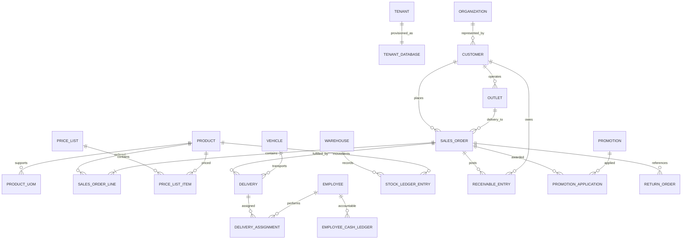

# Nghiên cứu bổ sung: glossary, ERD khái niệm và kịch bản nghiệp vụ MVP

> Nguồn: tài liệu đính kèm `deep-research-report (2)(1).md`. Đây là bản biên tập/tổng hợp, không phải bản sao nguyên văn. Tài liệu nguồn nêu rõ không truy cập được repo khi nghiên cứu; các định nghĩa, ví dụ và phát biểu pháp lý trong đó **chưa phải quyết định chính thức**. Đối chiếu với [báo cáo nghiệp vụ gốc](../2026-11-11-02-nghiep-vu-mvp-pwa/report.vi.md).

## Thuật ngữ đề xuất chuẩn hóa

| Thuật ngữ | Ý nghĩa trong hệ thống | Không được đồng nhất với |
|---|---|---|
| Tenant | Khách thuê SaaS; ranh giới bảo mật/cấu hình và một database riêng | Customer mua hàng của NPP |
| Doanh nghiệp / Organization | Pháp nhân hoặc tổ chức kinh doanh; có thể là tenant, nhà cung cấp hoặc khách hàng | Tenant trong mọi trường hợp |
| Customer / Khách hàng | Bên mua hàng hoặc bên có nghĩa vụ thanh toán với doanh nghiệp đang vận hành DMS | Chỉ người tiêu dùng cuối |
| Điểm bán / Outlet | Địa điểm vật lý giao hàng/viếng thăm/bán lẻ; một customer có thể có nhiều điểm bán | Customer hoặc phần mềm POS |
| NPP / Distributor | Vai trò thương mại của tổ chức mua hàng và phân phối lại | Tenant mặc định |
| Đại lý / Agent/Dealer | Vai trò kênh thương mại; phải phân biệt đại lý bán hộ (agency) với thương nhân mua đứt bán đoạn (dealer) | Một loại sở hữu hàng cố định |

**Lưu ý mâu thuẫn giữa hai tài liệu nghiên cứu:** một bản giới hạn `customer` là người mua cuối, bản còn lại bao gồm NPP/đại lý/điểm bán. Đề xuất chuẩn hóa **customer = đối tác mua hàng trong sổ bán hàng của tenant**, `outlet` là địa điểm; `channel_role` mô tả vai trò NPP/đại lý/điểm bán. Chưa coi đây là quyết định chốt cho tới khi phê duyệt glossary.

## ERD khái niệm đề xuất

Sơ đồ là **khái niệm**, chưa xác định khóa/kiểu dữ liệu, quan hệ tổ chức–khách hàng cần xác minh theo tenant, và không thay thế mô hình kế toán chi tiết. Các bảng nghiệp vụ nằm trong tenant DB; metadata định tuyến tenant thuộc control plane.

## Module A — Đặt trước, giao sau

1. Nhân viên thị trường/điện thoại/Zalo ghi nhận đơn, có thể offline.
2. Server xác nhận đơn, kiểm tra bảng giá, chương trình khuyến mại, công nợ và tồn kho; chờ duyệt khi vượt hạn mức.
3. Kho soạn/xuất, phân công phương tiện và nhân sự giao.
4. Giao hàng, ghi nhận đủ/thiếu/từ chối, thu tiền hoặc ghi công nợ; trả hàng về kho nếu cần.
5. Đối soát tiền và hàng, cập nhật sổ công nợ, báo cáo.

## Module B — Vansales

1. Xuất hàng từ kho chính sang kho xe/chuyến đi theo chứng từ điều chuyển.
2. Bán tại điểm, xuất từ tồn xe; ghi nhận tiền thu và công nợ.
3. Cuối tuyến kiểm đếm tồn xe, hàng hỏng/trả, tiền nhân viên giữ.
4. Đối soát chênh lệch và chuyển hàng còn lại về kho hoặc bàn giao chuyến kế tiếp theo chính sách.

**Nhân sự giao:** xe máy = `delivery_employee_id == driver_employee_id`; xe tải có thể khác nhau. Cần quy định trách nhiệm giữ tiền và giữ hàng độc lập với chức danh lái xe.

## Trạng thái đề xuất

- SalesOrder: `draft -> confirmed -> picking -> dispatched -> completed`; `cancelled` chỉ khi chưa ghi sổ không thể đảo ngược.
- Delivery: `created -> loaded -> in_transit -> delivered/partially_delivered/failed -> reconciled`.
- ReturnOrder: `requested -> approved -> received -> posted`.
- Thu tiền: `recorded -> verified -> remitted -> reconciled`.
- Promotion: `draft -> approved -> active -> expired/disabled`.

Mọi chuyển trạng thái phải có actor, timestamp và audit log; nghiệp vụ đã ghi sổ sửa bằng chứng từ đảo/điều chỉnh thay vì xóa.

## Các phép tính và tiêu chí kiểm thử từ báo cáo

| Chủ đề | Dữ liệu đầu vào | Kết quả kỳ vọng |
|---|---|---|
| UoM | 1 thùng = 12 chai, 1 lốc = 6 chai; bán 2 lốc + 3 chai | 15 chai quy đổi |
| FIFO | Nhập 10 × 8.000 và 10 × 10.000, xuất 12 | Giá vốn 100.000đ |
| Bình quân | Cùng dữ liệu trên, xuất 12 | Giá vốn 108.000đ |
| Giá vốn có phí mua | 100 chai giá mua 1.200.000đ, phí phân bổ 50.000đ | 12.500đ/chai |
| Thu hộ | Giao 1.000.000đ, nhân viên thu 600.000đ | Khách còn nợ 400.000đ; nhân viên cần nộp 600.000đ |
| Mua tặng | Mua 10 tặng 1; mua 9 | Lần lượt 1 quà và 0 quà, tùy chính sách hiệu lực |
| Tenant | User tenant A yêu cầu tài nguyên tenant B | Bị từ chối, không rò rỉ dữ liệu |
| Offline | Gửi lặp lại cùng lệnh tạo đơn | Chỉ có một đơn server, trả kết quả idempotent |

## Phạm vi MVP và hậu MVP

**MVP đề xuất:** sản phẩm/SKU/UoM; customer/outlet; bảng giá có hiệu lực; đơn hàng A/B; tồn kho chính/xe; giao hàng; thu hộ/tạm ứng; công nợ; khuyến mại mua-tặng hoặc giảm % đơn giản; PWA offline có đồng bộ an toàn; tenant-per-database; báo cáo cơ bản.

**Sau MVP:** tích điểm, ngân sách và giới hạn khuyến mại phức tạp, tích hợp ERP/EDI/thanh toán, phân tích nâng cao, đa quốc gia và custom fields sâu.

## Những điểm phải kiểm chứng

- Nguồn nghiên cứu có diễn giải không thống nhất về `customer`, `đại lý` và `tenant`; bảng glossary ở trên là **đề xuất giải quyết**, không phải trích nguyên văn.
- Không mặc định mọi hàng khuyến mại chịu VAT 0%; phải xác định đúng bản chất thuế và cách lập hóa đơn theo quy định hiện hành.
- Không giả định giá 1 thùng luôn bằng 12 lần giá chai, hoặc tất cả giá phải làm tròn tới 100/1.000đ.
- Không dùng timestamp đơn thuần để giải quyết mọi xung đột offline.
- Cần khảo sát thực tế: quy đổi đóng gói, giá vốn, luồng giao xe máy/xe tải, bán chịu, thu hộ, chính sách đổi trả, bảng giá, stacking khuyến mại, số liệu đối soát cuối ngày.

## Nguồn và xuất xứ

Bản nghiên cứu gốc đính kèm trích dẫn các tài liệu ngành DMS/ERP, tài liệu Microsoft về đa tenant, hướng dẫn UoM và các nguồn pháp lý Việt Nam; một số trích dẫn chưa đủ URL/điều khoản để kiểm chứng độc lập. Đối chiếu lại nguồn sơ cấp trước khi dùng làm ADR hoặc đặc tả tuân thủ.
